# RG Houdini Bridge guide

The full reference. For an overview, start with the [README](../README.md). For how it works inside, see [DEVELOPMENT.md](../DEVELOPMENT.md).

- [How it works](#how-it-works)
- [The Houdini sidebar](#the-houdini-sidebar)
- [Finding and applying tools](#finding-and-applying-tools)
- [Houdini modifiers](#houdini-modifiers)
- [Parameters](#parameters)
- [Inputs](#inputs)
- [Groups](#groups)
- [Attributes, UVs, colors and materials](#attributes-uvs-colors-and-materials)
- [Visualize](#visualize)
- [Native output](#native-output)
- [Timeline](#timeline)
- [Cache](#cache)
- [Apply](#apply)
- [Connection and feedback](#connection-and-feedback)
- [Opening a file](#opening-a-file)
- [Preferences](#preferences)
- [Scripting](#scripting)
- [Limitations](#limitations)
- [Troubleshooting](#troubleshooting)

## How it works

The add-on starts a `hython` process on your machine and talks to it over a local connection (127.0.0.1). Your geometry is sent to it, Houdini cooks the tool, and the result comes back into Blender.

- It needs Houdini 20.0 or later, and only Houdini 22.0 has been tested: the server runs on Python 3.10 at least, and an older `hython` stops with one line saying so in *Show Log*. The tool icons are drawn with Houdini's PySide6; without it, the shelf shows Blender's icons.
- Houdini starts on the first cook, and a first cold start can take several seconds.
- It stops by itself when Blender closes.
- While it runs, it holds a Houdini licence. Which one depends on the licences installed: with Houdini Indie, it was seen to take a Houdini Engine Indie licence first, when there is one. Houdini's License Administrator shows what is taken, and *Stop When Idle* frees it. Make sure your use fits the terms of your licence.
- Nothing runs on a remote machine.

## The Houdini sidebar

Open the sidebar with `N` in the 3D Viewport. The *Houdini* tab has a column of tabs: click one to show it, Shift+click to show several.

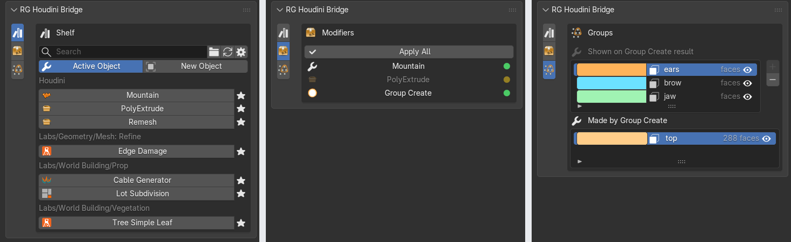

- **Shelf**: search, favorites, and where a tool goes when you click it.
- **Modifiers**: the Houdini modifiers of the active object, their state and errors; a click shows one in the Properties editor, where everything that sets it is (see [Houdini modifiers](#houdini-modifiers)). *Apply All* is here too.
- **Groups**: the point, edge and face groups of the active mesh.

## Finding and applying tools

### Where tools come from

- The HDA folders you add in the preferences. Subfolders are included, and `backup/` folders are skipped.
- SOP HDAs loaded by your Houdini packages, such as SideFX Labs.
- Houdini's own SOP nodes, such as PolyReduce, Boolean and Remesh.

One entry is listed per tool, the latest version only, like Houdini's Tab menu. The list is cached, so the shelf shows without starting Houdini. On a first install the shelf is empty: click *Read the Houdini Tools*. The refresh button of the shelf reads everything again.

### Sidebar shelf

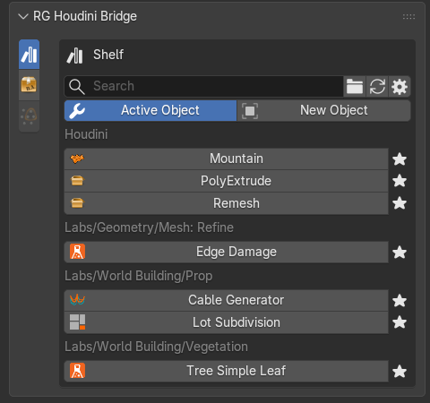

- With an empty search, the list shows your favorites.
- A search looks through every tool by name, type, category and help text.

  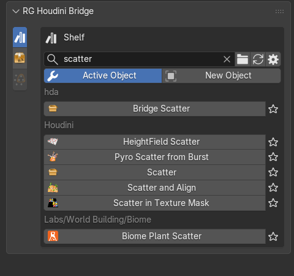

- The star adds or removes a favorite.
- The folder icon opens an HDA file directly. If it holds several HDAs, you choose one.
- The gear opens the add-on preferences.
- **Apply to** picks *Active Object* (the tool becomes a modifier) or *New Object*.

### Asset shelf

`Ctrl+Shift+H` opens a thumbnail popup with Houdini's icons and categories.

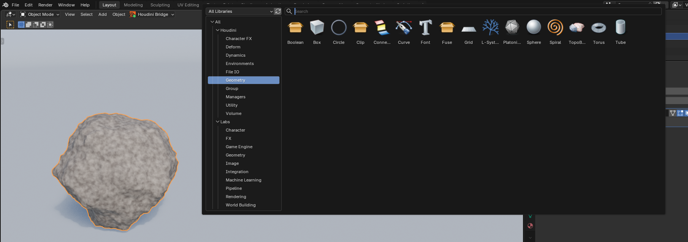

- Click a thumbnail to apply it, as set in *Apply to*.
- Drag it onto a mesh to add it as a modifier of that mesh. Drop it on empty space to make a new object there.
- Right click a thumbnail to add or remove a favorite.

The tools also appear in Blender's Asset Browser, as a library named *Houdini Bridge HDAs*.

### Favorites pie

`Shift+Alt+H` opens a pie with up to seven favorites and *All Houdini Tools*, which opens the asset shelf.

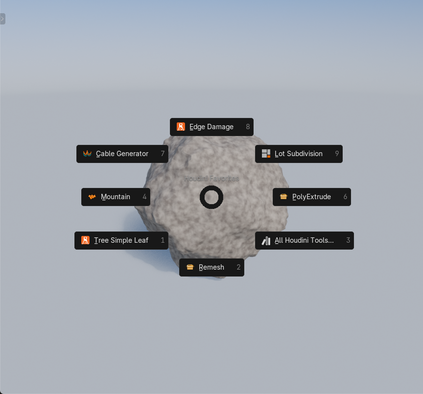

### Add menu

`Shift+A > Houdini HDA` lists your favorites and *Open HDA File*. Tools from this menu always make a new object.

### Add Modifier menu

In the Properties editor, *Add Modifier > Houdini* (also `Shift+A` over the modifiers, and the menu's search) lists your favorites. Right under *Add Modifier*, the *Add Houdini Node* button, with the Houdini logo, opens a search of every tool of the shelf, your favorites first, as Houdini's Tab menu does: type a few letters and pick one. A tool from this menu or this search always becomes a modifier of the object, a generator too, whose result then replaces the object's mesh in the stack.

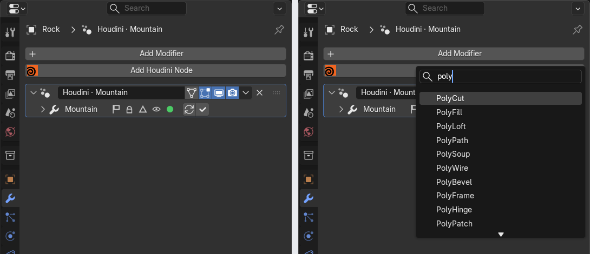

### What happens when you apply a tool

- **A tool with inputs, Apply to on Active Object**: it becomes a modifier of the active mesh or Volume object. Other selected objects fill its remaining inputs.
- **A tool with inputs, Apply to on New Object**: a new object is made at the origin, and the selected objects become its inputs.
- **A generator, a tool without inputs**: it always makes a new object, at the 3D cursor or where you dropped it.

## Houdini modifiers

A Houdini modifier is a Geometry Nodes modifier that shows the cooked result. It behaves like any modifier in the stack.

- Hide, reorder and remove it like any other. Move, rotate or duplicate the object freely.
- The original mesh stays editable. Object Mode and Edit Mode are tested. Sculpt Mode edits have not been checked.
- The modifiers above it are sent to Houdini, whether they are Blender or Houdini modifiers. Only modifiers shown in the viewport count.

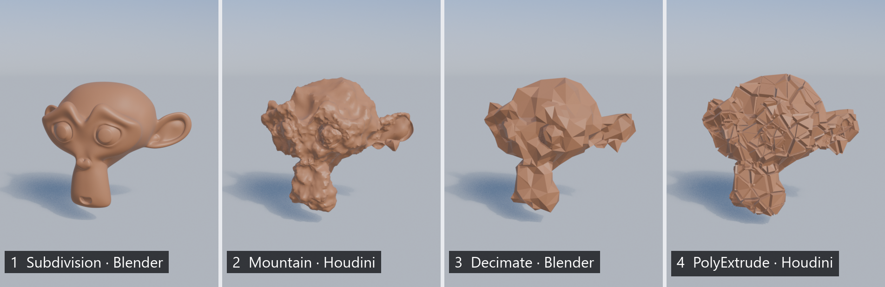

Everything that sets a Houdini modifier is in its panel of the Properties editor, *Modifiers* tab, as close to Houdini's parameter pane as Blender allows.

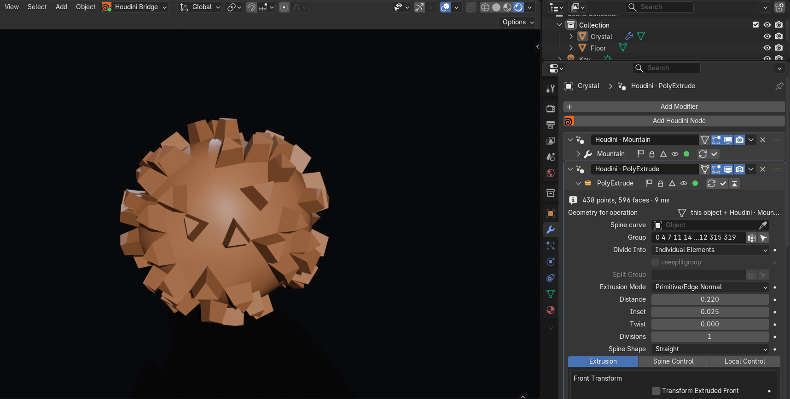

Under Blender's own header of the modifier (name, viewport and render switches, menu, cross), the panel of the HDA has a header of its own, the node row, which says what matters even while the panel is folded:

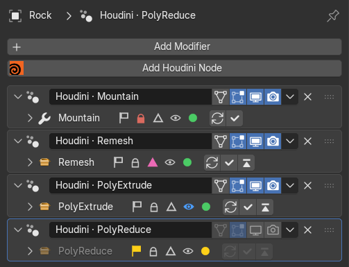

| Control | What it does |
|---|---|
| Arrow | Folds the panel of the HDA. Blender folds it at first on each modifier: click it once, and the modifier remembers it |
| Icon and name | The HDA's or node's icon, as the shelf shows it |
| Flag | **Bypass**, as Houdini's bypass flag: see below |
| Padlock | **Lock**, as Houdini's lock flag: see below |
| Triangle | **Template**, as Houdini's template flag: see below |
| Eye | **Display**, as Houdini's display flag: see below |
| Dot | The state: green up to date, orange cooking, red error, yellow bypassed, a grey ring when not cooked yet |
| Refresh | **Recook**: send every input again and cook |
| Check | **Apply** this modifier |
| Bar and arrow | **Apply** this modifier with all the modifiers above it. Shown when there are modifiers above |

Blender's cross removes the modifier; the add-on frees what it held within a second.

**Bypass.** The flag turns the HDA off in the viewport and in renders at once. The stack goes on without it, and Houdini does not cook it. A bypassed HDA's panel is faded, its flag is yellow and its status line says *Bypassed*. Click the flag again: the HDA comes back and cooks what changed meanwhile. With only one of Blender's two switches off, the HDA still cooks, the flag shows a yellow outline, and the status line says where it is off; a click then bypasses it. A bypassed HDA cannot be applied or cached. *Apply All* leaves it on the object.

**Lock.** The padlock keeps the result the modifier has: nothing cooks it but *Recook*, not a parameter, an input, the frame, a file opened or Houdini started again. Click it again: the modifier cooks what changed meanwhile. A cached modifier is locked while its cache plays, and its padlock is greyed out.

**Template.** The triangle, pink when set, draws this HDA's result as a ghost pink wireframe in the viewport, while the stack shows as usual: a step of the stack can be seen without cutting it. Several modifiers of an object may be templated at once. It draws the result the modifier keeps, so nothing is cooked for it; a bypassed modifier, one in error or one not cooked yet draws nothing. Only the mesh is drawn, not the instances, curves, points or volume of a result. The flag is saved with the file.

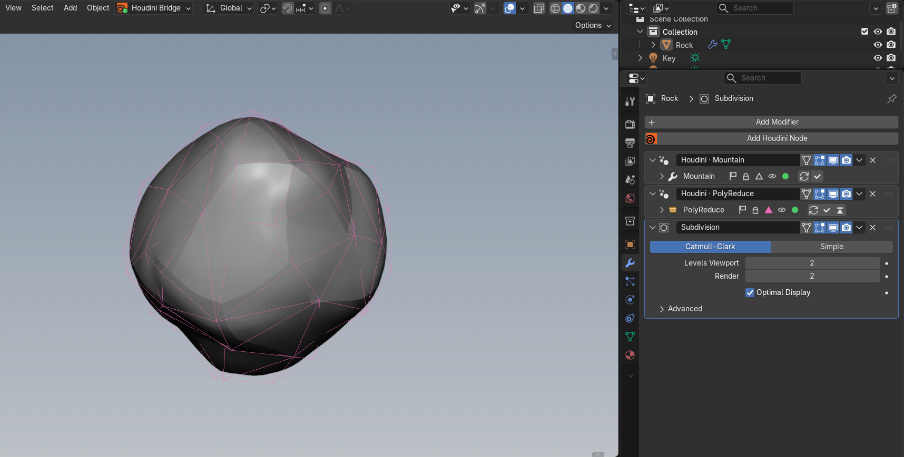

**Display.** The eye, blue when set, shows in the viewport the mesh at the output of this HDA: every modifier below it, whatever its type, is turned off in the viewport while the flag is set, and comes back as it was when the flag is lifted. One modifier per object has it: setting it on another one moves it. Renders are not touched. A modifier added or moved below the flagged one is turned off too, one moved above it comes back, and removing or applying the flagged modifier lifts the flag. Turning a modifier below back on, or bypassing it, by hand lifts the flag, as Houdini cannot run a node below its display flag: the stack comes back, and that modifier stays as you set it. A modifier already off before the flag stays off after it. Its status line says *below the Display flag*. A Houdini modifier below the flag still cooks, for the renders; it then reads the stack the viewport shows, without the modifiers the flag turned off, until the flag is lifted. While the flag cuts the stack, the viewport and the renders show two stacks: *Apply* refuses a modifier the flag turned off, and *Apply All* refuses the stack, until the flag is lifted (the flagged modifier itself applies, and the flag goes with it). The flag and what it turned off are kept through an undo and in the saved file. Disabling the extension lifts every Display flag of the open file; a file saved with a flag and opened without the extension shows the modifiers below off in the viewport, where the eye of Blender turns them back on.

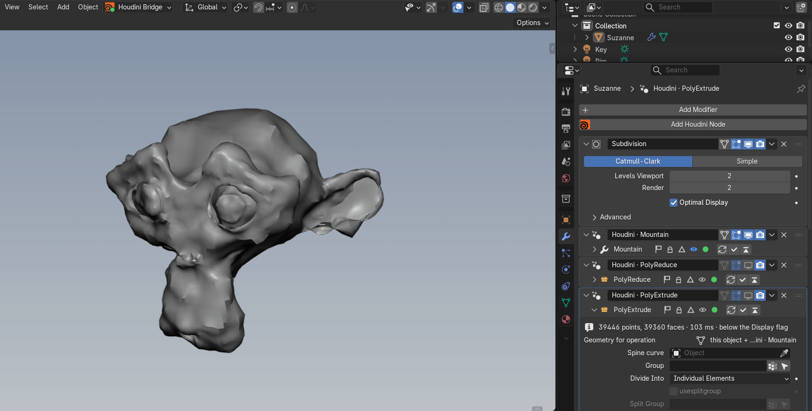

Under the node row: the status line (the last cook and its time, *animated* for an HDA that reads the time), the errors in red, *Update* when the shelf holds a newer version of the HDA, the inputs, the parameters, then two folded sections: *Output* (*Output* mode, *Instances in Viewport* when there are instances, *Visualize*, volume settings when there is a volume) and *Cache*.

**Update** switches to the newer version, and parameters with the same name keep their value.

An HDA saved again from Houdini is reloaded on the next cook, and its parameter list is rebuilt, keeping the values already set.

**The sidebar** (`N` in the 3D Viewport, *Houdini* tab, *Modifiers*) lists the Houdini modifiers of the active object, each with its icon, its state and the first line of its errors. Click one to show it in the Properties editor. *Apply All* applies the whole stack.

## Parameters

The panel draws the parameters in Houdini's order, in Houdini's folders.

| Tabs, menus, a group field | Multiparms, nested |
|---|---|
| 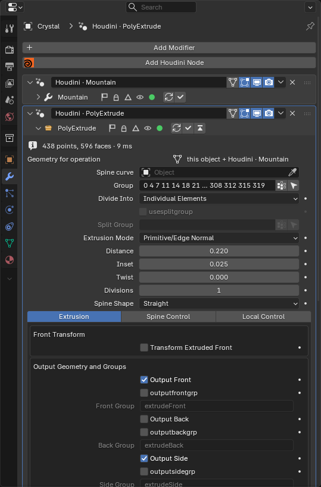 | 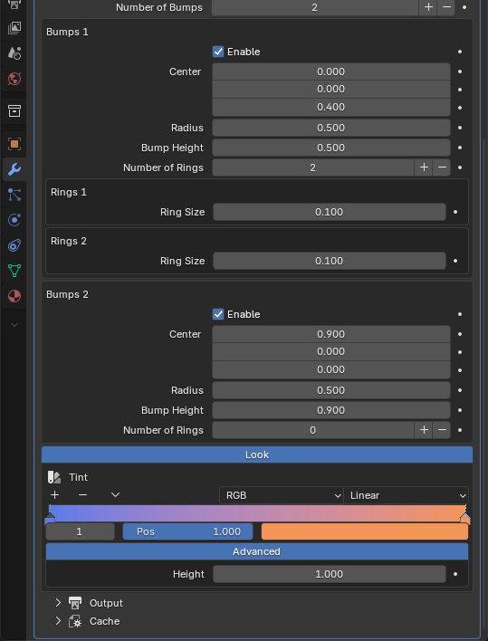 |

| In Houdini | In Blender |
|---|---|
| Float, integer | Number field |
| Vector of 2 to 4 | Vector |
| Color | Color |
| Toggle | Checkbox |
| String | Text field |
| Menu | Dropdown with Houdini's labels |
| Collapsible folder | A panel that folds |
| Simple folder | A box with its title |
| Tabs (and radio folders) | A row of tabs; only the open tab shows its parameters. Narrow editors put the tabs on several rows |
| Multiparm | A count with + and −, then one box per instance, nested multiparms included |
| Button | A button, at its place; buttons that follow each other share a row |
| Ramp | Curve or color ramp, at its place |
| Group field | The text field, the groups of the input and the selection arrow, on one row |
| Code (a wrangle's VEX, a Python SOP's script) | A code block: its first lines and an *Edit* button, which opens it in Blender's Text Editor |

The open tab of each set is kept until Blender closes; changing tabs changes nothing in the file. The parameters are inputs of the modifier's node group: the panel draws those inputs, and Blender's own drawing of them is hidden.

**Animation.** Parameters can be keyframed (`I` over a field, or its right click menu) and driven, as any Blender property, and Houdini cooks the animation frame by frame. Keyframes and drivers survive when the parameter list is rebuilt, as long as the parameter keeps its name and type.

**Expressions in Houdini.** A parameter Houdini drives with an expression or keyframes, like Time Shift's *Frame* (`$F`) or a field that reads another one with `ch()`, keeps following Houdini until you change its value in Blender: the new value then replaces the expression, as typing a value does in Houdini. Its field shows the value it had when the modifier was made. Two cases where that falls short:

- A value changed while Houdini is not running (a file opened that waits for *Allow Execution*, after *Stop* or *Stop When Idle*) is not sent at the next start: Houdini keeps its expression. Change it again once Houdini runs.
- A vector is sent whole: changing one component also sends the others, as the field shows them, and a component Houdini drives (`$F*0.1` in *ty* while you change *tx*) loses its expression for that value.

**Multiparms.** The count is a number, with + and − next to it as in Houdini. Changing it adds or removes instances and recooks. Number of Bumps gives Bumps 1, Bumps 2 and so on.

**Ramps.** A ramp is edited with Blender's curve or color ramp widget, at its place among the parameters. You can also edit it on its node in the modifier's node group. Houdini has one interpolation per key, and Blender has one per color ramp and a handle type per curve point. Houdini's interpolations are kept while Blender's own setting still matches them.

**Code.** A parameter Houdini edits in a code editor, like the VEXpression of an Attribute Wrangle or the script of a Python SOP, is drawn as a block: its first lines, then how many more there are, and under them the errors of the last cook in red, whole, with the line and column of a VEX error. *Edit* opens the code in Blender's Text Editor, in a window of its own as Houdini's floating editor, with line numbers and colors (VEX is colored as OSL, the closest language Blender knows, and Python as Python). Type there: a short pause after you stop typing, the code goes to the parameter and the modifier cooks again. *Edit* again while the window is open does nothing more. The parameter holds the code, and the text in the editor only mirrors it: it is made from the parameter each time the editor opens, follows the parameter when it changes otherwise (an undo, a script), and is never saved in the file. Closing the window, removing the modifier, undoing back to before *Edit* or opening another file closes the editor; what was typed stays in the parameter, and a save writes it there first. Houdini's presets of code (the menu next to a wrangle's code) are not offered.

**Group fields.** A text parameter that takes a group, like the Group field of Peak, stays free text. Next to it, a button lists the groups of the input. A field that takes several groups adds to the list.

**Selecting a group in the viewport.** When Houdini offers an arrow next to a group field (Group Create's Base Group, Blast's Group, Poly Extrude's Group…), the field has one too. Click it: the input of the modifier is shown in Edit Mode, framed in orange, with what the field holds already selected, and the badge and the status bar name the field, the node and the elements. Select points, edges or faces as usual, then press Enter: the field takes their numbers as Houdini writes them (`0-11 15 20-22`, edges as `p0-1-2 p5-6`), and a group type menu follows the elements selected. Esc cancels. The modifier and the ones below it are hidden meanwhile, and come back as they were. With no modifier above, you edit the object itself, as in Houdini; with modifiers above, a copy of what this modifier receives is shown instead, and edits of its geometry are not kept. Houdini's vertices (corners) cannot be selected. Saving the file cancels the selection, and says so. When the modifier right above is a Houdini modifier whose result holds instances, curves, a volume or loose points, the selection refuses to start: Houdini then numbers its input differently from the mesh Blender shows. A copy shown for the selection is left out of renders. Selected elements are written in order of their numbers, not in the order they were clicked. Enter and Esc are read in the window where the arrow was clicked: with the 3D view in another window, confirm from the first one.

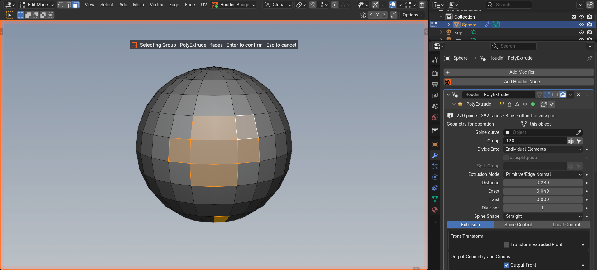

**Limits.** Houdini has two kinds of bounds: strict ones, locked in the parameter editor, and a slider range, which typing can leave. Blender inputs only have hard limits. The *Limits* preference chooses which Houdini bounds apply. The default keeps strict bounds and the slider minimum, so a Step Size cannot go negative by accident. Values are held within bounds however they are set, including by a driver or keyframe.

**Hidden and greyed out parameters.** Parameters that Houdini hides, from the values of other parameters, are hidden in Blender too, and a folder with nothing to show is not drawn. They show again at the cook that follows the change that shows them in Houdini. A hidden parameter keeps its value and keyframes, and is still sent to Houdini. When Houdini hides a whole folder, its parameters are hidden too, except for a tab of a set of tabs, which still shows. Turn off *Hide Like Houdini* to show every parameter. Parameters that Houdini greys out are drawn faded, as of the last cook, and stay editable.

**Houdini Interface.** Turn this preference off and Blender draws the parameters as plain Geometry Nodes inputs, folders as panels, with the node group selector; the panel of the HDA then only adds what an input cannot show (ramps, buttons, code blocks with their *Edit* button, group fields with their picker and arrow), and keeps its node row, status, *Output* and *Cache*. That is also the way to work on while the panel of the HDA misbehaves: every value is a plain input Blender draws, the ramps can be edited on their node in the node group too (*Ramp · <parameter>*, in a Geometry Nodes editor), and the buttons and the group arrows stay under the inputs. A file saved this way shows its parameters in a Blender without the add-on. With the preference on, such a Blender shows the Houdini modifiers empty: turn it off before saving a file for someone who does not have the add-on.

**A Geometry Nodes modifier that is not Houdini's** shows an empty, folded row at its bottom: the place of the HDA panel, which Blender draws under every Geometry Nodes modifier. It holds nothing. Blender 5.2 crashes with a panel drawn without this row, so it stays until Blender is fixed.

## Inputs

- A tool can have up to 4 inputs.
- On a modifier, input 1 is the object itself, with the modifiers above it.
- Other inputs are object pickers. They take a mesh or a Volume object, not a hidden result or the object carrying this modifier.
- Each input shows the label Houdini gives it ("Geometry to Reduce" on PolyReduce), or "Input 2" when the HDA leaves it unlabelled.
- A Volume object is read from its `.vdb` file. Its own modifiers are not read.

**In Edit Mode**, modifiers can recook live as you edit, or once when you leave Edit Mode. Set this in the preferences.

## Groups

The Groups panel works on the active mesh.

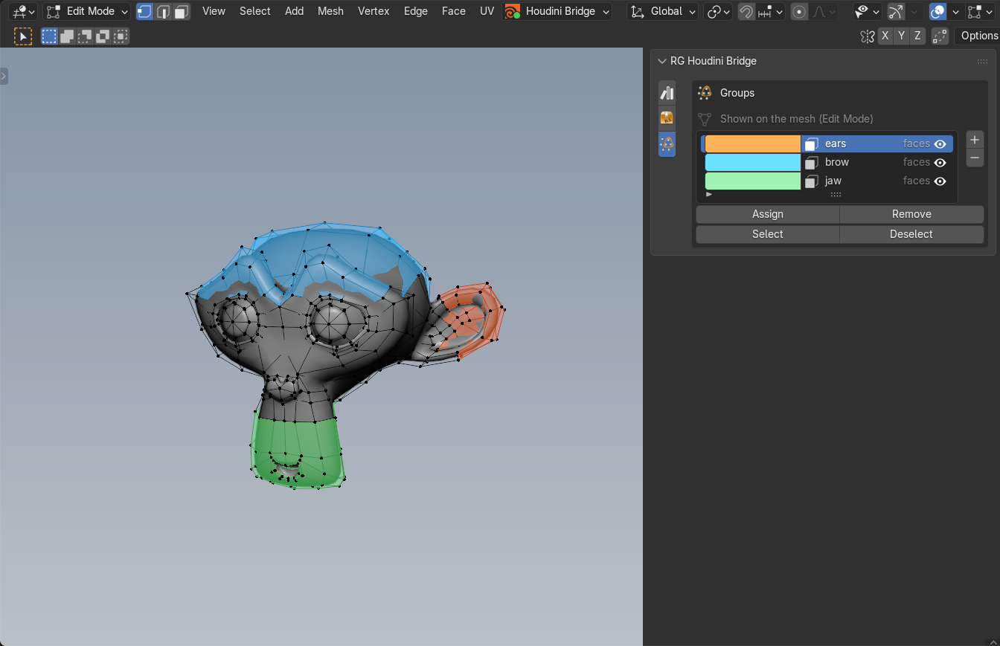

A group is a plain boolean attribute of the mesh, on points, edges or faces. The panel adds a color and a visibility toggle, and needs no other add-on.

In Edit Mode:

- **+** makes a group from the selection. Its type follows the select mode, with faces taking priority.
- **Assign** and **Remove** add or remove the selected elements.
- **Select** and **Deselect** act on the group. *Select* also switches to the group's select mode.

In any mode, **-** deletes the group and leaves the elements alone. Double click the name to rename it, which renames the attribute too. The eye shows or hides it.

**Where groups are shown.** The line at the top of the panel tells you. With a Houdini modifier active in Object Mode, the group is shown on that modifier's result, so you see what the modifier did with it. In Edit Mode, it is shown on the mesh being edited. A warning icon in the list means the group is missing from that result.

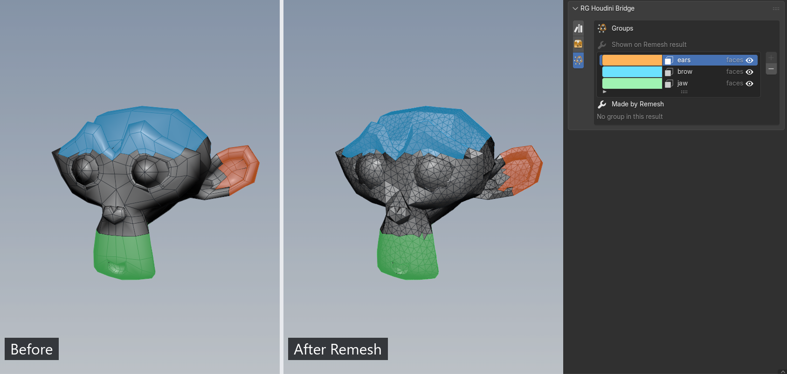

**Through the stack.** Every boolean attribute on points, edges or faces goes to Houdini as a group, under a valid Houdini name: `Top Row` becomes `Top_Row`. When two names clean to the same one, the second gets a suffix: `Top.Row` next to `Top Row` becomes `Top_Row_2`. That covers groups from this panel, groups made by a Houdini modifier above, and Geometry Nodes selections. `sharp_face` is left out. The Edit Mode selection itself is not sent.

Houdini's groups come back as boolean attributes, ready for the next modifier, the spreadsheet, shaders or Geometry Nodes.

**Groups made by Houdini.** The *Made by* list under the mesh's groups shows the groups of the active modifier's result, whether it made them or received them from a Houdini modifier above. It is refreshed by every cook, and a badge in the viewport repeats the counts. A group left with no element is gone: from this list, from the result and from the suggestions of the *Group* fields below it. A group made again with the same name and type replaces the one before, as in Houdini. New groups are shown straight away, in Object Mode and in Edit Mode. Each one has a color and an eye, kept from one cook to the next.

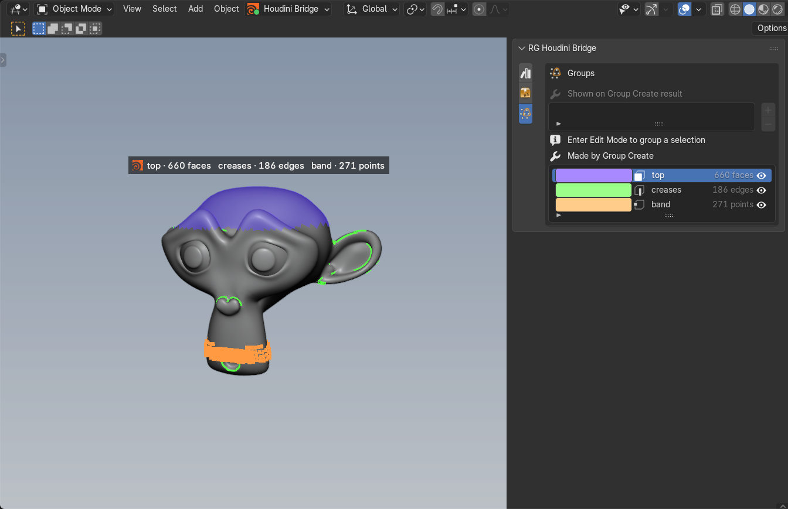

Only the active modifier's groups are drawn: click a modifier to look at its result. Groups of the mesh that pass through stay in the mesh's list, and nothing is drawn from this list while a cache plays. After *Apply*, they join the mesh's list.

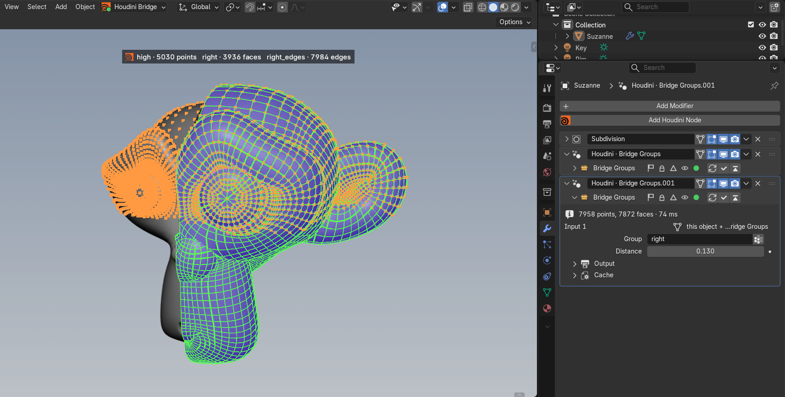

## Attributes, UVs, colors and materials

**To Houdini**

| In Blender | In Houdini |
|---|---|
| Attributes on points, faces and corners | Attributes with the same name, cleaned up for Houdini: `Weight Paint` becomes `Weight_Paint`, and a second name that cleans the same gets a suffix (`Weight_Paint_2`) |
| Vertex groups (painted weights) | Point float attributes |
| Active color attribute | `Cd`, plus `Alpha` when it is not opaque |
| Active UV map | `uv` |
| Other UV maps | 3-component texture coordinates |
| Custom normals | `N` |

Vectors are transformed by the input's placement and change axes like positions.

**Back to Blender**

- Positions, faces, UVs and normals.
- `Cd` as a color attribute.
- Every numeric attribute on points, primitives and vertices, with 1 to 4 components.
- Every point, primitive and edge group, as boolean attributes.
- Materials, see below.

Names that Blender keeps for itself, such as `sharp_edge` or `position`, get a `houdini_` prefix. Turn off *Attributes and Groups* in the preferences for lighter cooks of heavy meshes.

**Round trips** stay stable: a color stays a color, texture coordinates come back as a UV map, and 4 floats stay 4 floats, so an `orient` quaternion survives. Weights, colors, vectors and UV maps pass through stacked modifiers unchanged.

**Materials.** `shop_materialpath` on primitives selects materials. Blender uses the last part of the path as a material name: `/mat/rock` looks for a Blender material named `rock`, and makes an empty one if it does not exist. When the result names no material, it shows the materials of the object, so a material you assign to the object stays, cook after cook. Materials are not sent to Houdini, nor the faces' material index: on an object with several materials, every face of such a result takes the first slot.

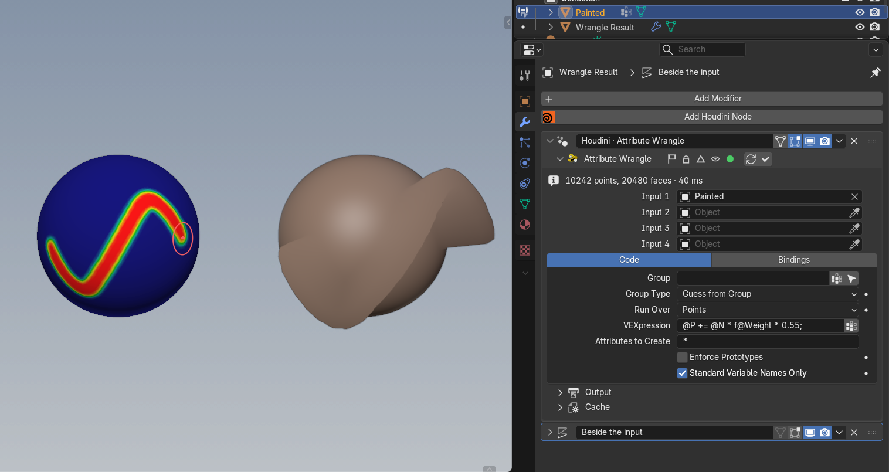

## Visualize

The *Visualize* menu of a modifier lists the attributes of its result. Groups are in the [Groups panel](#groups).

| Data | Drawn as |
|---|---|
| Single value, or 2 to 4 components | Blue to red ramp, over the 2nd to 98th percentiles |
| 3 components on points or faces | Arrows |

Each legend gives the range. Vectors with 2 or 4 components use the ramp on their length. While a cache plays, Visualize reads the cached frame.

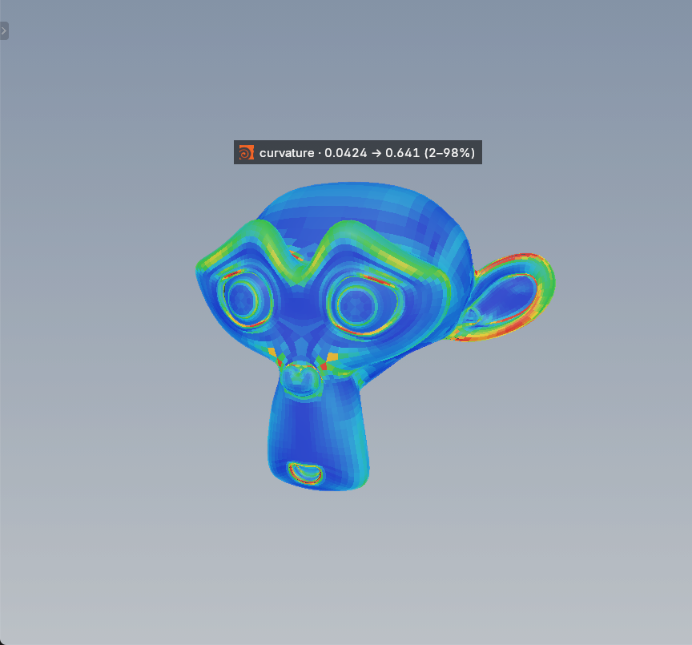

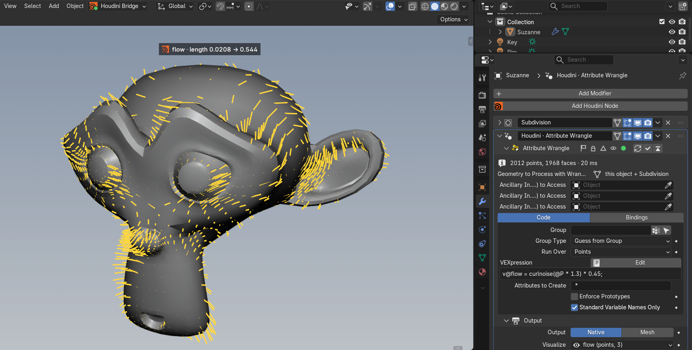

## Native output

The *Output* setting on each modifier decides what a result becomes.

**Native** is the default. A result can hold several of these at once, next to its mesh.

| In Houdini | In Blender |
|---|---|
| Packed primitives, fragments, packed disk primitives, Alembic references | Instances, each shape sent once and each copy a matrix |
| Quadric spheres | Instances of a polygon sphere, see *Sphere Detail* |
| Open curves | A Curves object, radius from `width` |
| Loose points | A point cloud, radius from `pscale` |
| Fog VDBs and Houdini volumes | A Volume object |
| Level sets | A Volume object that keeps the distance field |

`Cd` and numeric attributes come along, per instance too, and so does `shop_materialpath`. In shaders, read an instance's color with an Attribute node of type *Instancer*.

**Mesh** turns everything into one editable mesh: packed primitives are unpacked and open curves are dropped.

**Instances in Viewport.** *Auto* draws instances up to the *Points Beyond* preference (200,000 by default), and one point per instance past that. *Instances* and *Points* force either one. The render always gets the instances.

**Level sets.** A signed distance VDB, which is what VDB from Polygons gives by default, stays a distance field, ready for Blender's SDF grid nodes. Its default material renders the inside as solid. The Solid viewport shows it as smoke, like any grid.

**Volume settings.** A result's volume lives on a hidden object, so the modifier shows its settings in its *Output* section: viewport density, wireframe, interpolation, render space, step size, precision and clipping. Volumes use a default *Houdini Volume* material unless the result names one.

**Live `.vdb` files** are temporary. They go to the system's temporary folder or the *Live Volume Files* folder, are replaced at each cook, and are removed when Houdini stops.

A live volume is not saved in the .blend: opening the file again shows it only once it cooks, since its `.vdb` is gone. A file that waits for *Allow Execution*, and a locked modifier, show no volume until then, and *Apply* refuses it until a *Recook*. Use *Apply* to keep a volume as a file.

## Timeline

Houdini follows Blender's frame and frame rate. Frame 1 is time 0 on both sides.

A tool recooks on frame change when it reads the time (`$F`, `$T`, keyframes). The status line then shows *animated*. It also recooks when an input is animated: keyframes, shape keys, an armature, or Geometry Nodes reading the scene time.

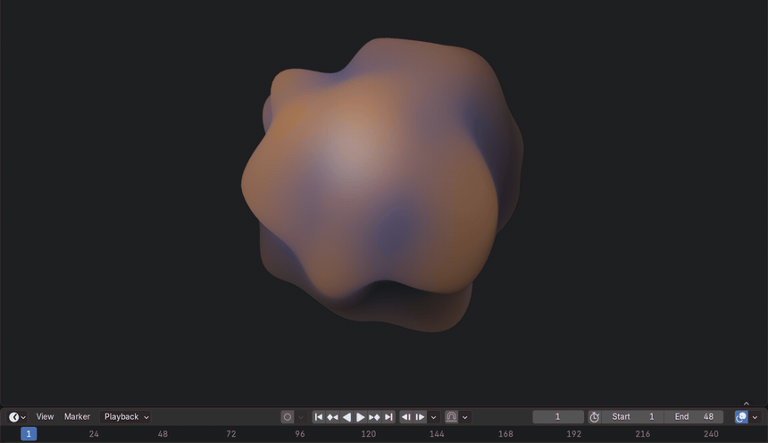

During playback, each frame can ask for a cook. Heavy tools will not keep up, and that is what the cache is for.

## Cache

Like a File Cache in Houdini, the *Cache* section of a modifier cooks a frame range once. Blender then plays and renders it without Houdini, frame accurately, with every attribute, group and material.

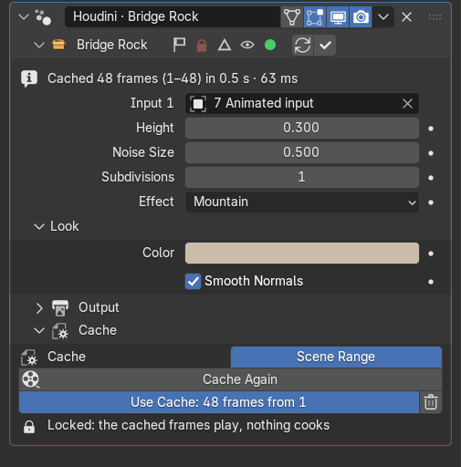

- **Scene Range** uses the scene's frames. Turn it off to set your own Start and End.
- **Cache Frames** cooks the range, with progress and *Cancel*. It becomes **Cache Again** once a cache exists.
- **Use Cache** switches between the cached frames and live cooking.
- The trash button deletes the cached frames.

Before the range the first frame stays, and after it the last.

The *Cache* section of the modifier warns when the parameters have changed since caching. Changes to the inputs are not tracked, so cache again when they change.

**Cost.** Cached frames are saved in the .blend file and all loaded in memory. That is fine for most tools, and heavy for millions of polygons over long ranges.

Each cached frame is one realized mesh. Curves, points and volumes are not cached.

## Apply

**Apply** (the check mark of the modifier's node row) freezes a modifier and drops its link to Houdini.

- The mesh becomes the object's mesh, and the result's groups join the Groups panel.
- Instances become a point cloud object instancing the shapes.
- Curves become a Curves object, and points a point cloud object.
- A volume becomes a Volume object reading a copy of the `.vdb`, kept where the *Output* preferences say.

If only one new object is left and the original has nothing else, the new object takes its place and its name. A Volume object also takes the modifiers below, so a Convert VDB keeps working.

**Apply as a block** (the bar and arrow) applies a modifier with every modifier above it. Its result already holds theirs. Use it for combos such as VDB from Polygons then Convert VDB, so no object appears in between.

**Apply All** (top of the panel) applies the whole stack: the last Houdini modifier as a block, then the Blender modifiers below it. Bypassed modifiers, and modifiers above it off in the viewport only, stay on the object. It refuses while a Display flag cuts the stack.

*Apply* and *Apply All* refuse, before changing anything, a volume whose live `.vdb` is gone (*Recook* first), and an object whose mesh Blender's Apply cannot change: a mesh shared by other objects (*Object > Relations > Make Single User* first), one with shape keys, or a linked one.

**Blender's own Apply**, in the modifier panel, cannot be intercepted and keeps only the mesh.

On a Volume object, Blender cannot apply the modifier, so the mesh becomes a mesh object of its own.

**Undo and redo** work: data comes back, and a modifier that lost its Houdini state recooks.

## Connection and feedback

The **Houdini Bridge** button in the viewport header shows the connection.

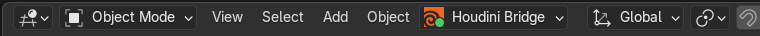

| Dot | Meaning |
|---|---|
| Grey ring | Stopped. Houdini starts with the first cook |
| Amber ring | Starting |
| Green | Ready |
| Orange | Cooking |
| Red | Error |

The Houdini logo in the button is rendered from your local install, so it appears once Houdini has run once. Until then the button shows the dot alone.

Click it for the version, *Start* or *Restart* and *Stop*, *Show Log* and *Preferences*.

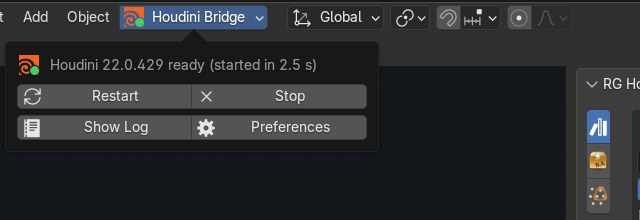

*Show Log* copies the hython output into a text block named *Houdini Bridge Log*, which you can read in the Text Editor.

**While cooking**, the object gets a pulsing orange box and a badge with the tool and the elapsed time, and a summary sits at the bottom of the viewport. The badge also shows the caching progress and when a newer change is waiting.

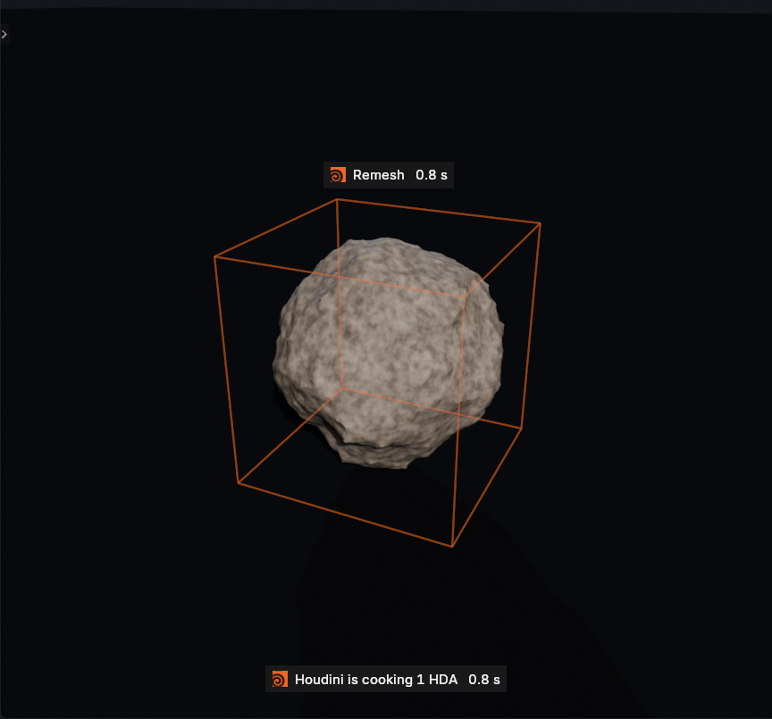

**When a cook fails**, a red badge appears on the object, the errors show in red in the modifier and in the sidebar, and the last good result stays in place.

## Opening a file

Opening a .blend file recooks its Houdini modifiers that are not locked: Houdini starts and loads the HDA files the file names. An HDA can run Python, so the extension follows Blender's *Auto Run Python Scripts* preference (*Preferences > Save & Load*), as for a file's own scripts.

- With the preference on, and the file outside its *Excluded Paths*, the file cooks as soon as it opens.
- Otherwise the file opens with the results saved in it, but no live volume (see [Native output](#native-output)), and nothing cooks: Houdini does not start and no HDA is loaded. The panel of each Houdini modifier and the *Houdini Bridge* menu of the viewport header say so, with an *Allow Execution* button.
- *Allow Execution* lets the file cook until you open another one. So does an action of yours on one of its Houdini modifiers: adding one, *Recook*, *Start*, *Cache Frames*, a button of the HDA. Changing a parameter does not: the panel keeps asking.
- Installing, updating, enabling or reloading the extension while such a file is open blocks it again, even after *Allow Execution*.
- On the command line, `--enable-autoexec` and `--disable-autoexec` count as the preference.
- Blender does not tell the extension that a file was opened as a *Trusted Source* (an option of *File > Open*), nor that Blender's own *Allow Execution* reloaded it: with the preference off, such a file asks too.

A new file, and your startup file, always cook.

## Preferences

*Edit > Preferences > Add-ons > RG Houdini Bridge*, or the gear in the sidebar shelf. Six tabs, each with collapsible sections.

### Modifiers

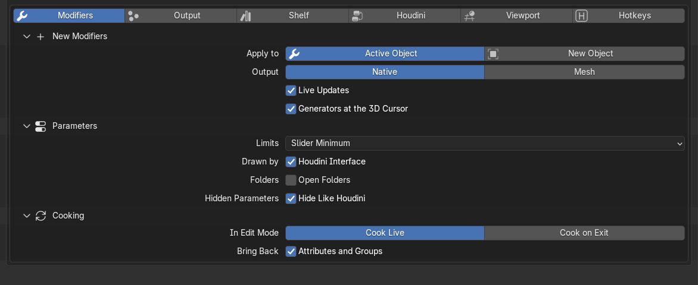

| Setting | Default | What it does |
|---|---|---|
| Apply to | Active Object | Where a clicked tool goes |
| Output | Native | Output of new modifiers |
| Live Updates | On | New modifiers recook on any change; off, they start locked (Lock) |
| Generators at the 3D Cursor | On | Off: at the world origin |
| Limits | Slider Minimum | *Strict Bounds*, *Slider Minimum* or *Slider Range*, see [Parameters](#parameters) |
| Houdini Interface | On | The add-on draws the parameters in the modifier, as Houdini does; off: Blender draws them as Geometry Nodes inputs, see [Parameters](#parameters) |
| Open Folders | Off | Houdini's collapsible folders start open in the modifier panel |
| Hide Like Houdini | On | Parameters Houdini hides are hidden in the modifier too |
| In Edit Mode | Cook Live | *Cook Live*, or *Cook on Exit* for heavy tools |
| Attributes and Groups | On | Bring back attributes and groups |

### Output

| Setting | Default | What it does |
|---|---|---|
| Points Beyond | 200,000 | With *Auto*, more instances than this show as points in the viewport |
| Sphere Detail | 4 (320 faces) | Frequency of the polygon sphere that stands in for quadric spheres |
| Curve Radius | 0.005 | Radius of curves with no `width` |
| Point Radius | 0.02 | Radius of points with no `pscale` |
| Live Volume Files | Empty | Folder for live `.vdb` files. Empty: the system's temporary folder |
| Applied Volumes | Next to the .blend | Where *Apply* keeps a `.vdb`: next to the .blend, or in a folder |
| Folder Name | `houdini_volumes` | Name of the folder next to the .blend |
| Relative Paths | On | Store the path relative to the .blend |

In a file not saved yet, an applied volume waits in the extension's folder and moves next to the .blend at the first save.

### Shelf

| Setting | Default | What it does |
|---|---|---|
| HDA Folders | None | Your folders, subfolders included, each with an on/off switch |
| Houdini Packages | On | List SOP HDAs from packages |
| Houdini Nodes | On | List Houdini's own SOP nodes |
| Every Version | Off | List every version of a tool. Takes effect at the next refresh |
| Hide | Empty | Tools to leave out: names or types, `*` as wildcard, separated by commas. Example: `*deprecated*, labs::ml_*` |
| Group by Category | On | Show categories in the sidebar list |
| Short Labs Names | On | Drop the "Labs" prefix |
| Search Help Text | On | Search also reads each tool's help line |
| Asset Shelf Levels | 2 | Depth of the category tree, 1 to 3. Deeper categories merge into their parent |
| Update When Houdini Starts | On | Read the tools the first time Houdini starts in a Blender session |

*Refresh* reads the tools now. Favorites stay when a tool is hidden.

### Houdini

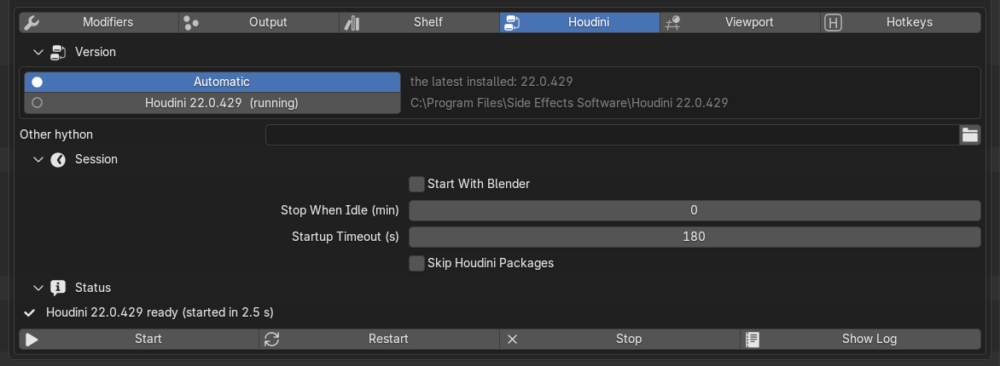

| Setting | Default | What it does |
|---|---|---|
| Version | Automatic | The latest installed, a version you pin, or *Other hython* for any executable |
| Start With Blender | Off | Start Houdini when Blender starts or opens a file with Houdini modifiers, unless the file waits for *Allow Execution* (see [Opening a file](#opening-a-file)) |
| Stop When Idle | 0 (never) | Stop Houdini after these minutes without a cook, to free the licence it holds. It starts again on the next cook |
| Startup Timeout | 180 s | How long to wait before giving up |
| Skip Houdini Packages | Off | Faster startup, but HDAs that depend on a package will not cook |

The *Status* section shows the state, with *Start*, *Restart*, *Stop* and *Show Log*.

### Viewport

| Setting | Default | What it does |
|---|---|---|
| Cooking Feedback | On | Boxes, timers and error badges |
| Visualizer Legend | On | The badges naming what Visualize shows, and the groups of the active modifier with their counts |
| Connection Indicator | On | The Houdini Bridge button in the header |

### Hotkeys

Rebind the asset shelf (`Ctrl+Shift+H`) and the favorites pie (`Shift+Alt+H`).

## Scripting

A Python script run in Blender, or with `blender --background --python`, uses the extension through `api.py`. It is the one module whose names stay the same from one version to the next; the other modules may move. The extension must be enabled.

```python
import bpy
from bl_ext.user_default.rg_houdini_bridge import api

api.start_server()  # waits until Houdini answers
bpy.ops.mesh.primitive_monkey_add()
remesh = {"type": "remesh::2.0", "label": "Remesh", "max_inputs": 1}
modifier = api.place_hda(bpy.context, "", remesh, "MODIFIER")  # "" for a Houdini node, else the HDA file
api.cook_now(modifier.node_group)  # the first cook lists the parameters
api.set_parameter(modifier, "targetsize", [0.05])
api.cook_now(modifier.node_group)
api.apply_modifier(bpy.context, modifier.node_group)  # the result becomes the mesh
api.stop_server()
```

- `api.place_hda` puts a tool on the active object (`"MODIFIER"`) or on a new object (`"NEW"`), as the shelf does. An HDA of a file takes the file's path and the tool's node type.
- `api.cook_now` cooks at once and waits. With `--background`, Blender runs no timer, so nothing cooks unless a script calls it.
- `api.set_parameter` takes a parameter by its Houdini name, numbers as a list (`[0.05]`, or one per component), a menu as its token.
- `api.houdini_modifiers`, `api.cache_now`, `api.refresh_shelf` and `api.stop_server` do what their names say.

Each function has a docstring: `help(api.place_hda)`.

## Limitations

**What can be used**

- SOP HDAs and SOP nodes only, with 4 inputs at most.
- Parameters not supported: data parameters. A set of radio folders is drawn as tabs, but the choice is not an input. The instances of a tabbed multiparm are boxes, not tabs.
- Parameter help shows as the tooltip of an input, not of a ramp or a button.
- Blender inputs have no soft slider range, only hard limits. Vectors are drawn as a column, not on one line.
- A tab Houdini hides by its own condition still shows (its state cannot be read in hython).
- The panel of the HDA starts folded on each modifier (Blender keeps that state per modifier and offers no way to set it), and a Geometry Nodes modifier that is not Houdini's shows an empty folded row: both come from a crash of Blender 5.2 with a panel drawn without a header.
- HDA viewport visualizers cannot be read from hython.
- The Template flag draws the mesh of a result only, not its instances, curves, points or volume.
- A file saved with a Display flag set, opened without the extension, shows the modifiers below the flag off in the viewport (renders keep them).

**Stacking**

- A Houdini modifier right below a live Houdini modifier gets its result as it is: VDBs, packed primitives, curves.
- With a Blender modifier in between, or a cached modifier above, it only receives the mesh.
- A packed primitive holding curves or volumes gives a mesh shape only.

**Towards Houdini**

- Blender has no integer attribute of 3 or 4 components: one from Houdini (an integer attribute of size 3 made by an Attribute Create) becomes a float vector, with its axes as they are, and goes back to Houdini as a float vector.

- Only meshes and Volume objects are sent. Instances, curves and points are not.
- Materials, string, quaternion and matrix attributes are not sent. Edge attributes are not sent either, since Houdini has none.
- A Volume object's own modifiers are not read. A packed volume, or one made by Geometry Nodes alone, has no file and counts as no input.

**Apply and cache**

- Blender's own Apply keeps only the mesh.
- The cache stores realized meshes. Curves, points and volumes are not cached.
- Cached frames are saved in the .blend and kept in memory.
- Input changes after caching are not detected.
- Blender 5.2 never reads a packed volume, so volumes are kept as files next to the .blend or in a folder, not packed.

**Rendering**

- Live cooks are paused during a render. Rendering an animation with a live time-dependent modifier does not update it from frame to frame: cache it first.

**Other**

- A new object from a tool with inputs is in world space with an identity transform. Modifiers work in local space.
- There is no cycle detection: making A an input of B and B an input of A is not caught.
- An object with several materials sees every face of a result Houdini gives no material take its first slot: the faces' material index is not sent to Houdini.
- A value of a parameter Houdini drives with an expression, changed while Houdini is not running, is not sent; changing one component of a vector replaces the expression of a driven component (see [Expressions in Houdini](#parameters)).
- A file opened as a *Trusted Source* while *Auto Run Python Scripts* is off still waits for *Allow Execution*: Blender does not tell an add-on how a file was opened.
- Sculpt Mode edits of the original mesh have not been checked.
- Windows is the only tested platform, and `build.ps1` is PowerShell.
- Blender 5.2 is the only tested Blender version.

## Troubleshooting

**The shelf is empty.** Click *Read the Houdini Tools* in the sidebar. If that fails, check the *Houdini* tab of the preferences.

**Houdini is not found.** The add-on looks in the usual install folders and, on Windows, in the registry. Set the path in *Other hython*.

**Houdini does not start, or the button is red.** Open *Show Log* from the header button and read what hython said. Check in Houdini's License Administrator that a licence is free. Raising *Startup Timeout* helps when many packages make a cold start slow, and *Skip Houdini Packages* shows whether a package is the cause.

**A cook fails.** The error shows in the modifier and in the sidebar, and the last result stays. Press *Recook* to send every input again.

**Nothing cooks in a file you opened.** *Auto Run Python Scripts* is off, or the file is in one of its *Excluded Paths*: click *Allow Execution* in the modifier's panel. See [Opening a file](#opening-a-file).

**Houdini stops at once, and the log says it needs Houdini 20.0 or later.** Its Python is older than 3.10: pick a newer Houdini in the *Houdini* tab of the preferences.

**A VDB looks like smoke.** That is how the Solid viewport draws any grid, including a level set. Check it in Cycles, or add Convert VDB below it.

**A Convert VDB shows nothing on a fog.** Convert VDB only turns a fog into polygons with an *isovalue* above 0. This is Houdini's own behaviour.

**An animation renders static.** Cache the modifier before rendering, see [Rendering](#limitations).

**Blender feels slow on a heavy tool.** Lock that modifier (its padlock), or set *In Edit Mode* to *Cook on Exit*.

**A Houdini modifier shows nothing but its header in a Blender without the add-on.** The file was saved with *Houdini Interface* on: install the add-on, or save it again with the preference off.
